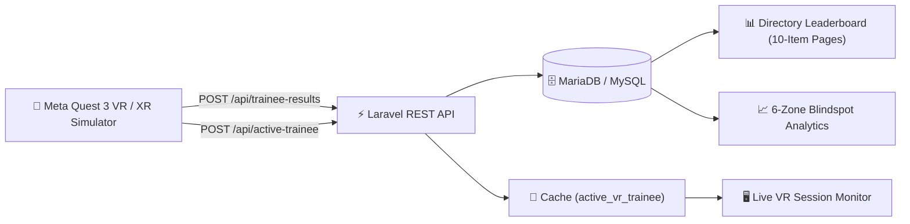

# ⚠️ FindHazard VR — Supervisor Glass Dashboard

> **Real-time telemetry evaluation & command center for VR aviation cargo hazard drills.**  
> Built with **Laravel 11**, **Tailwind CSS**, and **JetBrains Mono**. Ingests spatial inspection results from Meta Quest 3 VR headsets and Unity XR Interaction Simulator.

---

## 🧭 System Overview



---

## 🗂️ Clean Codebase Structure & Key Files

Here is the quick guide to where everything is located and what each file does:

| File / Directory | Purpose & Responsibility |
|---|---|
| [`app/Http/Controllers/TraineeResultController.php`](file:///c:/xampp/htdocs/laravel/FindHazardAdmin/app/Http/Controllers/TraineeResultController.php) | **HTTP Controller**: Handles VR REST API requests and renders Blade dashboard views. Kept lean and easy to read. |
| [`app/Services/HazardEvaluationService.php`](file:///c:/xampp/htdocs/laravel/FindHazardAdmin/app/Services/HazardEvaluationService.php) | **Business Logic Service**: Master configuration of the 6 Warehouse Zones & 13 Hazards, detection analytics, trainee zone breakdowns, and automated supervisor statements. |
| [`app/Models/TraineeResult.php`](file:///c:/xampp/htdocs/laravel/FindHazardAdmin/app/Models/TraineeResult.php) | **Eloquent Model**: Database representation with convenient accessors (`formatted_time`, `formatted_score`, `wrong_clicks_penalty`) and scopes (`leaderboard()`, `certified()`). |
| [`routes/api.php`](file:///c:/xampp/htdocs/laravel/FindHazardAdmin/routes/api.php) | **VR REST API Endpoints**: Ingests drill results and active trainee sync from Unity VR. |
| [`routes/web.php`](file:///c:/xampp/htdocs/laravel/FindHazardAdmin/routes/web.php) | **Web Navigation Routes**: Defines multi-page dashboard views (`/overview`, `/monitor`, `/directory`, `/analytics`, `/guide`, `/trainee/{id}`). |
| [`resources/views/partials/`](file:///c:/xampp/htdocs/laravel/FindHazardAdmin/resources/views/partials/) | **Modular Blade Partials**: `tab-overview.blade.php`, `tab-monitor.blade.php`, `tab-directory.blade.php`, `tab-analytics.blade.php`, `header.blade.php`, `footer.blade.php`. |
| [`public/js/dashboard.js`](file:///c:/xampp/htdocs/laravel/FindHazardAdmin/public/js/dashboard.js) | **Client JavaScript Engine**: 10-item directory pagination, search/filtering, WebRTC MQDH video cast, and dynamic KPI count-up animations. |
| [`public/css/dashboard.css`](file:///c:/xampp/htdocs/laravel/FindHazardAdmin/public/css/dashboard.css) | **Visual Stylesheet**: Dark glassmorphism, ambient lighting orbs, 3D holographic isometric cube, and scanning gridlines. |

---

## 📡 VR Headset / Unity API Integration

The Unity application (`findhazardvr`) communicates with this dashboard using `LaravelApiBridge.cs`:

### 1. Ingest Completed Session Telemetry
- **Endpoint**: `POST /api/trainee-results`
- **Headers**: `Content-Type: application/json`
- **Payload Example**:
  ```json
  {
    "username": "Hafiz_Pilot",
    "hazards_found": 11,
    "hazards_missed": 2,
    "wrong_clicks": 1,
    "completion_time": 84.5,
    "found_hazards": ["Exposed Power Cable", "Fluid & Oil Leak Slip Hazard"],
    "missed_hazards": ["Overloaded Forklift", "Damaged ULD"]
  }
  ```
- **Response**: `201 Created` with computed score, rating, and certification status.

### 2. Live Active Trainee Synchronization
- **Set Active Trainee**: `POST /api/active-trainee` (Called when trainee enters drill)
- **Clear Active Trainee**: `POST /api/active-trainee/clear` (Called when drill ends)
- **Poll Monitor Status**: `GET /api/live-monitor/status` (Polled every 2s by the web monitor)

---

## 📐 Scoring & Evaluation Methodology

| Metric | Rule / Calculation |
|---|---|
| **Total Industrial Hazards** | Exactly **13 hazards** distributed across 6 warehouse zones. |
| **Base Detection Score** | `(hazards_found / 13) * 100` (~7.69% per hazard). |
| **Trigger Discipline Penalty** | `-5.0%` deduction per misclicked safe object / distractor. |
| **Final Clamped Score** | `max(0.0, min(100.0, base_score - (wrong_clicks * 5.0)))`. |
| **Passing Qualification** | **$\ge 80.0\%$** required for official VR Safety Certification. |
| **Performance Tiers** | **Locked In** ($\ge 90\%$), **Great** ($\ge 80\%$), **Valid Effort** ($\ge 60\%$), **Needs Review** ($< 60\%$). |

---

## 🏢 The 6 Warehouse Zones & 13 Safety Hazards

1. **✈️ Aircraft Parts Storage Area**
   - Hazard #1: Fluid & Oil Leak Slip Hazard
   - Hazard #2: Dislodged Aircraft Parts
2. **📦 Cargo Storage Area**
   - Hazard #3: Unstable Cargo Stack
   - Hazard #4: Blocked Emergency Exit
3. **🚜 Main Cargo Handling Area**
   - Hazard #5: Overloaded Forklift
   - Hazard #6: Unsecured Boxes
4. **📐 ULD Storage Area**
   - Hazard #7: Improperly Stacked ULD Container
   - Hazard #8: Damaged ULD
5. **⚡ Loading/Unloading Area**
   - Hazard #9: Exposed Power Cable
   - Hazard #10: Accumulated Packaging Debris
   - Hazard #11: Crushed Bottom Pallet Base
6. **🛫 Airside Cargo Area**
   - Hazard #12: Tarmac Foreign Object Debris (FOD)
   - Hazard #13: Dislodged Restraint Net on PMC Pallet

---

## 🚀 Running & Testing

### Prerequisites
- **XAMPP**: Apache (Port 80) and MariaDB/MySQL (Port 3306) running.
- **PHP 8.2+** with PDO MySQL, OpenSSL, and cURL extensions.

### Local Access URLs
- **Supervisor Dashboard**: [http://127.0.0.1/laravel/FindHazardAdmin/public/](http://127.0.0.1/laravel/FindHazardAdmin/public/)
- **API Health Check**: [http://127.0.0.1/laravel/FindHazardAdmin/public/api/live-monitor/status](http://127.0.0.1/laravel/FindHazardAdmin/public/api/live-monitor/status)

### Helpful Artisan Commands
```bash
# Check registered routes
php artisan route:list

# Clear application cache
php artisan cache:clear

# Clear compiled view cache
php artisan view:clear

# Run database migrations
php artisan migrate
```
